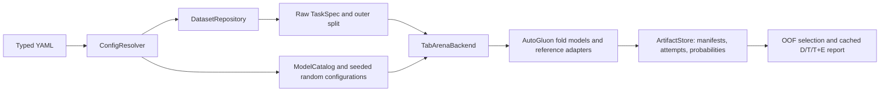

# Implementation status and remaining qualification

Updated 2026-11-07 for repository publication. The main protocol is implemented. This record distinguishes executable behavior from qualification; it does not certify the full campaign or published-score reproduction.

## Executable design

The central configuration/search-space layer is an in-process service. There is one active benchmark execution path. The obsolete holdout/TPE trainer and shared CSV writer were retired; old result files were not migrated or deleted.

Temporary fit files are discarded after every attempt; immutable prediction/metadata artifacts remain. Unused GPU memory is released between attempts, including failures.

The main defaults are twelve datasets, eleven methods, one stratified three-fold outer partition's first split, eight inner folds, one default plus 25 random configurations, outer/model seed 42, search seed 42, and one provisional hour per configuration. Grouped tasks use a group-disjoint outer partition and group-constrained inner folds. The pinned TabArena release's automatic tiny-data 5×5 rule is disabled for this thesis profile. Actual inner validation indices are persisted and checked for coverage, classes, and group leakage. The native IID bag splitter's own seed is recorded in model metadata; `outer_seed` is not a claim that every upstream component uses that same number.

Model implementations are deliberately heterogeneous where the methods require it:

- MLP: an explicitly configured ReLU/dropout dense baseline, AdamW, train-only scaling and bounded one-hot encoding (at most 256 outputs per categorical feature). It is not labeled an exact reproduction of a particular published MLP recipe. The targeted overfitting baseline still needs its separate recipe freeze.
- FT-Transformer: `rtdl-revisiting-models==0.0.2`, with feature-specific numerical tokenization and categorical embeddings. Searched FFN dropout is consumed. Validation/inference batches respect the fit-memory ceiling and the configured prediction limit.
- TabNet: `pytorch-tabnet==4.1.0`, categorical embeddings, task-aware validation metric, explicit device, and singleton-safe training batches.
- RealMLP, ModernNCA, TabM: pinned TabArena adapters using their reference packages/implementation. Integration guards preserve training-fold category vocabularies and align unknown held-out categories. TabM and ModernNCA receive fold seeds. A scoped ModernNCA compatibility shim supplies the seed omitted by TabArena 0.1.0's noisy quantile-transformer factory and restores the original factory even on failure. The shim assumes the enforced sequential fitting policy; replace it before adding threaded fits in one process.
- KNN: native optimized LOO for IID tasks, eight group-constrained fits for Diabetes. Categoricals are fixed to one-hot encoding, with the upstream ordinal/drop threshold excluded from tuning. Neighbor count, distance weighting, Minkowski exponent, and scaler remain tunable. Quantile subsampling is seeded independently of prior jobs; the effective neighbor cap is recorded. Native time-budget subsampling can reduce the neighbor bank; available/effective training rows are recorded. Large one-hot matrices and LOO inference require a memory/runtime pilot.
- XGBoost and CatBoost: task-aware classification, explicit CPU/thread allocation; CatBoost retains native categorical handling.
- TabPFN: `tabpfn==9.2.0`, pinned TabPFN-3.5 base checkpoint revision/hash, full outer development context, fixed inference settings, no HPO/fold ensemble. Its fixed inference seed is 0 and it uses eight estimators. Actual checkpoint loading/inference remains unqualified on this host.

**KNN LOO caveat:** optimized child LOO excludes each row's label from its neighbor prediction, but fits preprocessing on the full outer development population. It is not exact leave-one-out refitting of every transformation. This is the declared native validation exception. Grouped KNN uses ordinary fold-local preprocessing. All other bagged methods fit learned preprocessing inside the inner training fold.

## Verification

The source/lock and package identity match the earlier 71-test CPU verification, including configuration/data/metric regressions, multiclass adapter interfaces, grouped splitting, failed-job handling, actual fold execution, resume and cached reporting. A shortened real-data Ionosphere LR/MLP pilot completed with compatible resume. Four UCI routes were prepared; actual Diabetes inner and outer splits had no patient overlap, retained all three classes, and validated each development row once. These are infrastructure and interface checks, not model-ranking results or a GPU-hour forecast.

A synthetic CPU smoke also completed four configuration jobs, 32 fold fits and six D/T/T+E rows. Repeating it preserved job records, predictions and attempt histories, and manual report regeneration succeeded. Run the documented checks again after code changes or on a new worker. Foundation constructor/checkpoint API checks do not demonstrate actual inference.

GPU execution, actual TabPFN loading/inference and Docker build/runtime are not qualified. The previous host could not initialize CUDA, lacked Compose and could not access the Docker daemon. The deployment definitions remain a candidate until tested on the target machine.

## Scientific scope

The accepted twelve-source pool covers naturally small, wide, imbalanced, mixed/categorical/numerical and multiclass classification. German Credit, Ionosphere and Bioresponse replace the earlier California Housing, Bank Marketing and Jannis candidates. The [dataset selection](dataset-selection.md), [method selection](study-model-selection.md) and [evaluation protocol](tabarena-evaluation.md) own the scientific choices. Twelve qualified sources support bounded comparative claims; they do not guarantee statistical power or universal superiority.

## Remaining qualification

1. Audit all twelve raw sources for distinct provenance, duplicates, leakage, feature timing, groups, sentinels and cohort rules. Freeze normalized input hashes and prediction populations. A configured temporal field currently raises `NotImplementedError`; temporal splitting is not implemented.
2. Qualify the real GPU worker, actual pinned TabPFN access/inference, full-size high-cardinality/wide/100-class paths, runtime, RAM/VRAM, artifacts, interruption/recovery and container execution. Native time budgets are advisory rather than hard process deadlines.
3. Implement the two required targeted runners: fold-specific class weighting, independent paired training seeds, validation-selected rare-class thresholds, competent fixed MLP recipe, nested training-only subsets, matched regularization controls and learning curves.
4. Freeze primary contrasts, multiplicity, effect sizes and uncertainty. The reporting CLI does not provide the final inferential analysis, Elo, threshold optimization or calibration studies. Keep datasets as across-task inference units; inner folds and reporting conditions are dependent.
5. Preserve committed source, prepared input hashes, dependency lock, checkpoint, split manifests and measured budgets before the campaign. The runner records executable source/lock digest, packages and hardware; record Git commit and image digest separately.

Use [setup](setup.md) for installation and operation. Do not treat required but unimplemented mechanism studies as part of the main `run` command.
