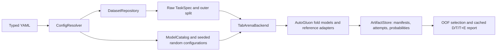

# Implementation status and remaining qualification

Updated 2026-11-07 for repository publication. The main protocol is implemented. This record distinguishes executable behavior from qualification; it does not certify the full campaign or published-score reproduction.

## Executable design

The central configuration/search-space layer is an in-process service. There is one active benchmark execution path. The obsolete holdout/TPE trainer and shared CSV writer were retired; old result files were not migrated or deleted.

Temporary fit files are discarded after every attempt; immutable prediction/metadata artifacts remain. Unused GPU memory is released between attempts, including failures.

The main defaults are twelve datasets, eleven methods, one stratified three-fold outer partition's first split, eight inner folds, one default plus 25 random configurations, outer/model seed 42, search seed 42, and one provisional hour per configuration. Grouped tasks use a group-disjoint outer partition and group-constrained inner folds. The pinned TabArena release's automatic tiny-data 5×5 rule is disabled for this thesis profile. Actual inner validation indices are persisted and checked for coverage, classes, and group leakage. The native IID bag splitter's own seed is recorded in model metadata; `outer_seed` is not a claim that every upstream component uses that same number.

Model implementations are deliberately heterogeneous where the methods require it:

- MLP: an explicitly configured ReLU/dropout dense baseline, AdamW, train-only scaling and bounded one-hot encoding (at most 256 outputs per categorical feature). It is not labeled an exact reproduction of a particular published MLP recipe. The targeted overfitting baseline still needs its separate recipe freeze.
- FT-Transformer: `rtdl-revisiting-models==0.0.2`, with feature-specific numerical tokenization and categorical embeddings. Searched FFN dropout is consumed. Validation/inference batches respect the fit-memory ceiling and the configured prediction limit.
- TabNet: `pytorch-tabnet==4.1.0`, categorical embeddings, task-aware validation metric, explicit device, and singleton-safe training batches.
- RealMLP, ModernNCA, TabM: pinned TabArena adapters using their reference packages/implementation. Integration guards preserve training-fold category vocabularies and align unknown held-out categories. TabM and ModernNCA receive fold seeds. A scoped ModernNCA compatibility shim supplies the seed omitted by TabArena 0.1.0's noisy quantile-transformer factory and restores the original factory even on failure. The shim assumes the enforced sequential fitting policy; replace it before adding threaded fits in one process.
- KNN: native optimized LOO for IID tasks, eight group-constrained fits for Diabetes. Categoricals are fixed to one-hot encoding, with the upstream ordinal/drop threshold excluded from tuning. Neighbor count, distance weighting, Minkowski exponent, and scaler remain tunable. Quantile subsampling is seeded independently of prior jobs; the effective neighbor cap is recorded. Native time-budget subsampling can reduce the neighbor bank; available/effective training rows are recorded. Large one-hot matrices and LOO inference require a memory/runtime pilot.
- XGBoost and CatBoost: task-aware classification, explicit CPU/thread allocation; CatBoost retains native categorical handling.
- TabPFN: `tabpfn==9.2.0`, pinned TabPFN-3.5 base checkpoint revision/hash, full outer development context, fixed inference settings, no HPO/fold ensemble. Its fixed inference seed is 0 and it uses eight estimators. Actual checkpoint loading/inference remains unqualified.

**KNN LOO caveat:** optimized child LOO excludes each row's label from its neighbor prediction, but fits preprocessing on the full outer development population. It is not exact leave-one-out refitting of every transformation. This is the declared native validation exception. Grouped KNN uses ordinary fold-local preprocessing. All other bagged methods fit learned preprocessing inside the inner training fold.

## Verification

Santander source revision **2026-11-12**: live OpenML metadata confirmed dataset 46859 version 2, target `TARGET`, 76,020 rows, 369 numerical predictors and no `ID`. Offline regressions cover the configured automatic-source roster, OpenML version/schema/cache reuse and preservation/rejection of the former local-CSV cache. Ruff passed, **161 tests passed**, and CPU smoke completed **4 jobs, 32 fold fits and 6 report rows**. The Santander-only plan resolved the new source. Standard frozen `make check` and smoke remained blocked by the read-only uv cache, so checks used the existing Python 3.11 environment explicitly with `PYTHONPATH=src`. The complete Santander data file was not downloaded, and no GPU or full-campaign run was performed.

The 2026-11-11 local-wrapper budget revision replaces deadline exceptions after completed training with predictive epoch stopping for MLP, FT-Transformer and TabNet. MLP/FT-Transformer restore their best completed checkpoint after a later partial epoch; TabNet exits normally through its native best-weight callback after finishing the current epoch. Zero completed epochs still fail. Fold metadata records truncation, completed epochs, granted seconds, wrapper fit seconds and effective batch size. FT-Transformer caps its effective batch using a 4 GiB single-attention-score allowance with an eight-row floor; this does not guarantee total VRAM feasibility. Deterministic regressions cover best-weight retention, partial epochs, zero-epoch failure, unlimited fits, the AutoGluon metadata bridge and the memory cap throughout fit/validation/inference. The proposal reports campaign timeout/OOM counts from another worker checkout; those counts have not been independently verified here. At that revision, automatic batch thresholds remained pending; the 2026-11-12 revision below supersedes that batch policy.

Revision verification: Ruff passed, **89 CPU tests passed**, and the synthetic CPU smoke completed **4 jobs, 32 fold fits and 6 report rows**. Saved MLP child records contained the five training metadata fields. Frozen installation and standard `make check`/smoke commands were blocked by a read-only uv cache and unavailable package downloads; verification instead used the existing Python 3.11 environment explicitly with `PYTHONPATH=src`. The real-data GPU pilot was not run because CUDA was unavailable. These checks do not qualify a fresh frozen installation, GPU training or the full campaign.

The accepted 2026-11-12 batch-space revision adds fold-local automatic batch sizing and a `{0.5, 1, 2}` multiplier search for MLP, FT-Transformer and TabNet, with default multiplier 1. TabNet weights training rows by fold-local categorical cardinality and selects its virtual batch from the same threshold table. Explicit physical batches ignore the multiplier; FT's cap and TabNet's singleton correction remain active. TabNet's virtual batch is clamped to the physical batch, then increased when necessary to prevent singleton BatchNorm chunks in full and remainder batches; the corrected value is recorded. Invalid/non-finite multipliers and virtual batches below two fail parameter validation; tiny positive multipliers resolve safely to the eight-row minimum. Other methods and scientific/dependency pins are unchanged. The [evaluation protocol](tabarena-evaluation.md) records thresholds and the required replacement of all 36 local method/dataset pairings. No campaign reruns or GPU performance qualification are included in this revision.

Local verification of the 2026-11-12 revision: Ruff passed and **158 tests passed**, including **69 new batching checks**. CPU smoke completed **4 jobs, 32 fold fits and 6 report rows**, with MLP default folds recording batch 64 and sampled folds recording batch 128. Its directory is `results/runs/smoke/adba1d18a7691e63031b28dbf76529df79ac3ac0f3a71302919f58c85bb5c94b`. The three-method Ionosphere plan resolved automatic batches, default multiplier 1 and the revised multiplier spaces with 78 configuration jobs. Frozen `make check` and smoke remained blocked by a read-only uv cache; a writable offline cache also lacked Hatchling. Checks therefore used the existing Python 3.11 environment via `PYTHONPATH=src` and explicit `python -m` invocations. Astra review identified the virtual-singleton case; after correction it reported no remaining findings and independently checked 139,284 chunking combinations against pinned `torch.chunk`. GPU execution, full-size throughput/memory and fresh frozen installation remain unqualified. Earlier verification evidence above is preserved.

The 2026-11-06 verification recorded 71 passing CPU tests, including configuration/data/metric regressions, multiclass adapter interfaces, grouped splitting, failed-job handling, actual fold execution, resume and cached reporting. A shortened real-data Ionosphere LR/MLP pilot completed with compatible resume. Four UCI routes were prepared; actual Diabetes inner and outer splits had no patient overlap, retained all three classes, and validated each development row once. These are infrastructure and interface checks, not model-ranking results or a GPU-hour forecast.

A synthetic CPU smoke also completed four configuration jobs, 32 fold fits and six D/T/T+E rows. Repeating it preserved job records, predictions and attempt histories, and manual report regeneration succeeded. Run the documented checks again after code changes or on a new worker. Foundation constructor/checkpoint API checks do not demonstrate actual inference.

GPU execution, actual TabPFN loading/inference and Docker build/runtime are not qualified. The previous host could not initialize CUDA, lacked Compose and could not access the Docker daemon. The deployment definitions remain a candidate until tested on the target machine.

## Scientific scope

Source revision **2026-11-12**: Santander Customer Satisfaction now uses OpenML dataset 46859 version 2 with target `TARGET`, through the existing OpenML downloader. Live OpenML metadata reports 76,020 rows, 369 predictors and two classes; the mirror already removes `ID`. All twelve accepted datasets now have automatic acquisition: eight OpenML sources and four UCI archives. The old local-CSV source, prepared cache and results are not overwritten or silently relabeled. Legacy/custom CSV loading remains supported. The remaining raw-data equivalence, row-order and hash audits still apply; metadata verification does not establish a completed raw-data audit.

The accepted twelve-source pool covers naturally small, wide, imbalanced, mixed/categorical/numerical and multiclass classification. German Credit, Ionosphere and Bioresponse replace the earlier California Housing, Bank Marketing and Jannis candidates. The [dataset selection](dataset-selection.md), [method selection](study-model-selection.md) and [evaluation protocol](tabarena-evaluation.md) own the scientific choices. Twelve qualified sources support bounded comparative claims; they do not guarantee statistical power or universal superiority.

## Remaining qualification

1. Audit all twelve raw sources for distinct provenance, duplicates, leakage, feature timing, groups, sentinels and cohort rules. Freeze normalized input hashes and prediction populations. A configured temporal field currently raises `NotImplementedError`; temporal splitting is not implemented.
2. Qualify the real GPU worker, actual pinned TabPFN access/inference, full-size high-cardinality/wide/100-class paths, runtime, RAM/VRAM, artifacts, interruption/recovery and container execution. Native time budgets are advisory rather than hard process deadlines.
3. Implement the two required targeted runners: fold-specific class weighting, independent paired training seeds, validation-selected rare-class thresholds, competent fixed MLP recipe, nested training-only subsets, matched regularization controls and learning curves.
4. Freeze primary contrasts, multiplicity, effect sizes and uncertainty. The reporting CLI does not provide the final inferential analysis, Elo, threshold optimization or calibration studies. Keep datasets as across-task inference units; inner folds and reporting conditions are dependent.
5. Preserve committed source, prepared input hashes, dependency lock, checkpoint, split manifests and measured budgets before the campaign. The runner records executable source/lock digest, packages and hardware; record Git commit and image digest separately.

Use [setup](setup.md) for installation and operation. Do not treat required but unimplemented mechanism studies as part of the main `run` command.

## Documentation alignment evidence

The 2026-11-07 reconciliation compared all tracked Markdown, YAML comments, entry-point help and source docstrings with the implementation, tests, lock and installed pinned upstream code. Local ignored planning documents were also checked for current-workflow claims; explicitly historical audit bodies and the dated verification JSON remain historical evidence. Literature claims and external links were not independently revalidated. The accepted pool, protocol, dependency pins and checkpoint were unchanged.

| Corrected mismatch or missing boundary | Implementation evidence |
| --- | --- |
| `BaseModel` documentation claimed every benchmark model inherited it, required already-imputed inputs and described Optuna search. It now describes local wrappers, raw inputs and catalog-owned random search, including KNN's native spaces. | [Local registry](../src/tabular_thesis/models/registry.py), [catalog](../src/tabular_thesis/experiments/catalog.py), [local preprocessing](../src/tabular_thesis/models/preprocessing.py), [direct KNN](../src/tabular_thesis/models/non_dl/knn.py). |
| Compatibility data docs listed obsolete source routes and promised dtype preservation. Holdout helpers did not identify their separation from the main protocol. | [Loader](../src/tabular_thesis/data/loader.py) forwards YAML routes; [repository](../src/tabular_thesis/data/tasks.py) accepts `openml`, `uci_zip`, `local_csv`; [preprocessor](../src/tabular_thesis/data/preprocessor.py) converts categorical values to strings; [splitter](../src/tabular_thesis/data/splitter.py) uses ordinary stratified holdouts without groups. |
| Statistical/plotting helper docs omitted limits relevant to thesis interpretation; seed docs overstated deterministic guarantees. | [Statistical helpers](../src/tabular_thesis/evaluation/statistical.py) delegate directly to SciPy; [plot helper](../src/tabular_thesis/evaluation/visualization.py) fills missing entries with zero; [seed helper](../src/tabular_thesis/utils/reproducibility.py) uses `warn_only=True`. None is invoked by the main reporting/training path. |
| “CPU-only installation” implied different dependencies. Setup also described previous host failures as current-machine facts. | [Bootstrap](../scripts/bootstrap.sh) always runs the same `uv sync --frozen`, then forwards options to doctor. Device choice changes execution, not the lock or saved YAML. Historical host qualification is now explicitly dated. |
| Smoke counts omitted their dependence on the retained fold setting and did not disclose replacement of user model overrides. | [CLI smoke branch](../src/tabular_thesis/experiments/cli.py) replaces name, models, datasets, overrides and random count; it does not assign `inner_folds`, seeds, runtime or paths. |
| Native search-space and prediction-batch controls needed explicit limits. | [Catalog](../src/tabular_thesis/experiments/catalog.py) returns upstream candidates before reading YAML search spaces; [backend](../src/tabular_thesis/experiments/backend.py) forwards the prediction limit only to local adapters. MLP/FT/TabNet consume it. |
| Report cost, retry and memory fields lacked definitions, risking double-counted search costs or inference-memory claims. | [Reporting](../src/tabular_thesis/experiments/reporting.py), especially `attempt_seconds` and condition-row construction; [runner records](../src/tabular_thesis/experiments/runner.py). [Setup](setup.md#report-costs-and-memory-boundaries) documents exact aggregation and pinned upstream fit-only memory tracking. |
| Ignored current-workflow notes linked to a removed F01–F20 section and claimed the implementation was still untracked. | The published status has no historical disposition table; `git ls-files` includes the implementation. `.gitignore` excludes local plans/handoffs, archives and verification snapshots. Their navigation/status wording was corrected locally without publishing those notes. |

Source docstring corrections change the executable-source digest because [artifact identity](../src/tabular_thesis/experiments/artifacts.py) hashes whole Python files. Existing results are preserved, but subsequent runs use a new study directory even though executable behavior is unchanged. The earlier verification identity therefore must not be presented as the current source identity.

Reconciliation checks: Ruff passed; pytest passed **71 tests** (45 warnings); the CPU smoke produced **4 jobs, 32 fold fits and 6 report rows**; the default plan reported **12 datasets, 11 methods and 3,132 jobs**. All local links and heading anchors in the nine tracked Markdown files resolved. An AST comparison against the pre-edit source, with docstrings removed, confirmed no Python behavior changes.

The standard frozen CLI invocation could not complete environment synchronization: the default uv cache was read-only, and an alternate writable cache could not fetch the Hatchling build requirement because DNS access failed. A no-sync `make check` attempt passed Ruff but selected a stale pytest launcher from a relocated environment and failed collection. Checks therefore used the existing Python 3.11 interpreter explicitly, with `PYTHONPATH=src`: `.venv/bin/python -m pytest -q`, `.venv/bin/python -m ruff check src scripts tests`, and `.venv/bin/python -m tabular_thesis.experiments.cli` for help, plan and CPU smoke. Installed recorded package versions matched the earlier pinned verification. This validates the installed environment and source, not a fresh frozen installation, GPU execution, TabPFN inference or container qualification.
